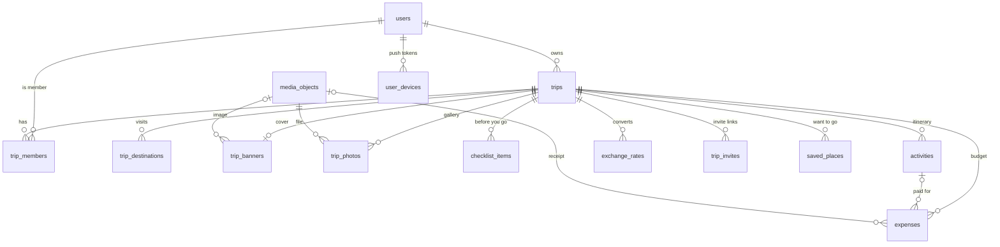

# Database schema (PostgreSQL)

The backend owns the database. Neither client connects to it directly. The schema lives in versioned migrations in [`backend/migrations/`](../backend/migrations), and the API applies them on start-up (`AUTO_MIGRATE=true`). It requires **PostgreSQL 15+**, because it uses `ON DELETE SET NULL (column)`.

| Migration | Contents |
|---|---|
| `00001_init.sql` | `users`, `trips`, `trip_members` |
| `00002_domain_schema.sql` | Everything else: trip details, gallery, checklist, itinerary, budget, collaboration, sync, reliability, audit, reporting |
| `00003_saved_places.sql` | `saved_places` (the map's saved places, mobile schema v5) |
| `00004_imported_packages.sql` | Lossless mobile import snapshots with media, owned by newly created web trips |
| `00005_trip_plans.sql` | Versioned editable web planning documents, including media, separate from the original import |

## Entity overview

Plus the append-only tables `sync_changes`, `idempotency_keys`, `outbox_events` and `audit_log`.

## Tables

| Table | Purpose | Key rules enforced in the database |
|---|---|---|
| `users` | People, created on first sign-in from the OIDC `sub` | `subject` unique |
| `trips` | Trip aggregate root | Title 1–200 chars; end ≥ start; end needs start; departure time `HH:mm` and needs a start date; 1–999 travelers; ISO currency; budget ≥ 0 and needs a currency; valid stage and travel style; `version` for ETags |
| `trip_members` | Who can see or edit a trip | Role ∈ owner / editor / viewer |
| `trip_destinations` | Ordered cities/countries (position 0 = main) | City or country required; unique position per trip |
| `trip_banners` | Cover design (non-destructive crop) | Zoom 1–4×, focal point −1…1, ARGB colors |
| `media_objects` | Catalogue of files in object storage (S3/R2) | Allowed MIME types, ≤ 50 MB, SHA-256 |
| `trip_photos` | Gallery entries | — |
| `checklist_items` | "Before you go" tasks | `done_at` set ⇔ done |
| `activities` | Itinerary: visits, meals, transport, hotel stays | 13 kinds incl. `transport` (mode TBD). **Times are optional**: both or neither (never guessed). Ends after it starts (overnight via `end_date`). Coordinates in pairs and in range. Booking reference stored **encrypted** (`booking_reference_ciphertext`) |
| `expenses` | Planned and actual spending | Amount ≥ 0; ISO currency; 14 categories. A linked activity must be in the **same trip**; deleting it unlinks the expense (`ON DELETE SET NULL (activity_id)`) |
| `saved_places` | Places saved on the map (attractions, restaurants, hotels, airports, stations) | Name required; **coordinates required** and in range (never invented); known category |
| `exchange_rates` | 1 unit of currency = `rate` × trip currency | Rate > 0; `source='manual'` means not verified |
| `trip_invites` | Join-by-link | Only a **SHA-256 hash** of the token is stored; expiry, max uses, revocation |
| `user_devices` | Push notification tokens | Platform ∈ ios / android / web |
| `sync_changes` | Change feed for the app's pull sync | Filled by **triggers** on every trip table; tombstones survive trip deletion |
| `idempotency_keys` | Safe retries (`Idempotency-Key` header) | Per user; purged after 24 h by a job |
| `outbox_events` | Transactional outbox for push, email and webhooks | Partial index on unpublished rows |
| `audit_log` | Security and support trail | Indexed by trip and by actor |

## Sync design

Every insert, update and delete on a trip table fires `record_sync_change()`. That function appends `(seq, trip_id, entity_type, entity_key, op, version, changed_by)` to `sync_changes`.

- The API runs `SET LOCAL app.user_id = '<uuid>'` in each transaction, so changes are attributed to the right user.
- Clients pull `WHERE trip_id IN (my trips) AND seq > :cursor ORDER BY seq` and then fetch the changed rows.
- Because the trigger captures changes, a code path can't forget to record one. Deleting a trip leaves `delete` tombstones for every child row, so other devices remove them too.

## Reporting

The `trip_budget_summary` view computes each trip's **planned** total (activity costs + planned expenses) and **spent** total (actual expenses), in the trip currency, using the trip's own exchange rates. These are the same rules as the app. Amounts without a rate are left out and counted in `unconverted_lines` rather than guessed.

## Verified

The schema was checked against a real PostgreSQL 16:
- Migrations apply, roll back to zero and apply again.
- 25 checks pass: every constraint above rejects bad data, triggers record changes with the acting user, the cross-trip expense link is refused, the budget view converts currencies, and trip deletion cascades and writes tombstones, and saved places need real coordinates and are synced.
- The backend's repository integration test passes against it.

## Web imports

`imported_trip_packages` stores a JSONB package (`document` and base64 `media`)
for each imported trip. Trip metadata and owner membership are created in the same
transaction. Packages cascade on trip deletion and are readable only through the
membership-checked API. The original imported package remains immutable. Editable web plans use `trip_plans` with atomic version checks. Neither document is materialized into the normalized planning tables or included in device sync. See [the web planner guide](WEB_PLANNER.md).
